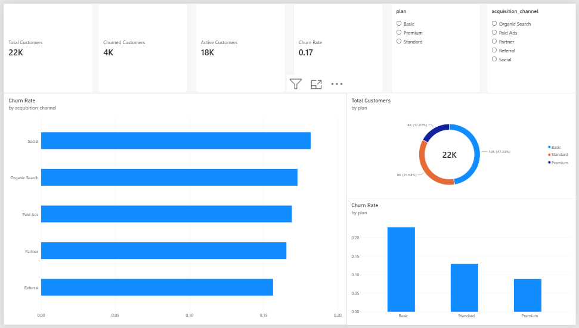
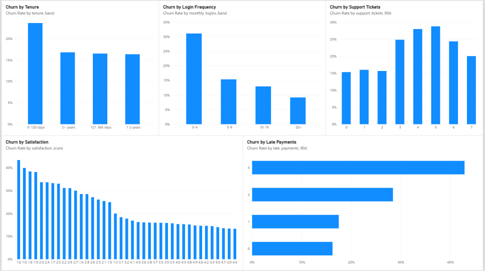

# Customer Churn Analysis

A portfolio analytics project exploring customer churn patterns for a fictional subscription business. The project uses SQL and Power BI to measure churn and compare churn rates across subscription plans, acquisition channels, tenure, login frequency, support tickets, late payments, and satisfaction scores.

> **Dataset note:** This is a synthetic portfolio dataset, not real company or customer data.

## Repository structure

```text
Customer-Churn-Analysis/
├── data/
│   └── customers_raw.csv
├── sql/
│   └── customer_churn_analysis.sql
├── powerbi/
│   └── customer_churn_analysis.pbix
├── docs/
│   └── dashboard-screenshots/
│       ├── executive_overview.png
│       └── churn_driver_analysis.png
└── README.md
```

## Business objective

Understand the scale of customer churn and identify customer segments that show higher churn rates. The analysis is intended to help a subscription business prioritise retention investigations and customer-support improvements.

## Tools

- **SQL (SQLite):** data standardisation, duplicate handling, aggregation, and segment-level churn analysis.
- **Power BI:** KPI cards, slicers, and comparative charts.
- **CSV:** source dataset.

## Key metrics

| Metric | Result |
|---|---:|
| Total customers after deduplication and standardisation | 22,000 |
| Churned customers | 3,720 |
| Active customers | 18,280 |
| Overall churn rate | 16.91% |

## Key findings

- **Subscription plan:** Basic customers have the highest churn rate (22.79%), followed by Standard (12.96%) and Premium (8.84%).
- **Login frequency:** Customers with 0–4 monthly logins have a 31.08% churn rate, compared with 9.17% among customers with 20+ logins.
- **Tenure:** Customers in the 0–120 day tenure band have a 23.65% churn rate.
- **Support tickets:** Churn is higher among customers with 3–5 support tickets in the previous 90 days (approximately 24.80%–28.74%).
- **Late payments:** Churn is higher among customers with two or three late payments, but these groups are much smaller than the zero- and one-late-payment groups.

These are descriptive associations. They do not establish that a plan, login frequency, support ticket, or payment pattern causes churn. Smaller segment sizes should be considered before making business decisions.

## Dashboard

### Executive Overview

The overview page presents total customers, churned customers, active customers, overall churn rate, churn by acquisition channel, customer distribution by plan, and churn rate by plan.



### Churn Driver Analysis

The analysis page compares churn rates by tenure, monthly login frequency, support-ticket count, satisfaction score, and late-payment count.



## How to use the SQL

1. Create or open a SQLite database.
2. Import `data/customers_raw.csv` as a table named `customers_raw`.
3. Open and run `sql/customer_churn_analysis.sql`.
4. The script creates a temporary view that standardises plan and acquisition-channel labels, converts the monthly fee to a numeric value, normalises the churn flag, and keeps one row per customer ID.
5. Run the analysis queries in the script to reproduce the KPI and segment comparisons.

The script uses SQLite syntax and window functions.

## Data notes and limitations

- The raw CSV contains duplicate customer IDs and inconsistent text formatting; the SQL script addresses these for the analysis view.
- Some satisfaction scores are missing, so satisfaction analysis excludes records without a score.
- Signup dates are largely missing, so a reliable signup-month trend is not presented.
- Very small groups (for example, customers with four or more late payments) should not be over-interpreted.
- The Power BI report is included as a `.pbix` file. The dashboard screenshots are provided for quick preview.

## Files

- `data/customers_raw.csv` — original raw dataset.
- `sql/customer_churn_analysis.sql` — SQL cleaning view and churn analysis queries.
- `powerbi/customer_churn_analysis.pbix` — Power BI report.
- `docs/dashboard-screenshots/` — exported dashboard page screenshots.
